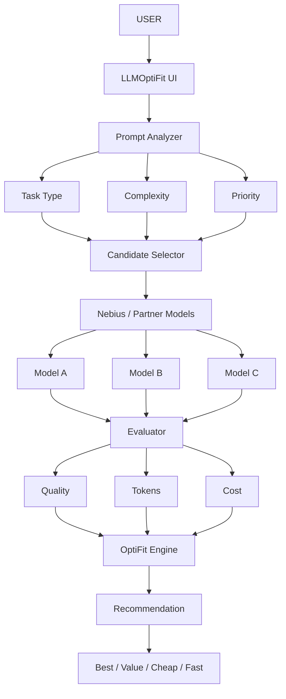

# LLMOptiFit

**Compare LLMs. Optimize cost. Choose the right fit.**

LLMOptiFit is an AI model comparison and recommendation platform designed to help users identify the most suitable Large Language Model for a specific task.

With the growing number of LLM providers, model families, and model variants, choosing the right model is becoming increasingly difficult. Different models vary significantly in reasoning ability, accuracy, context limits, latency, token consumption, and pricing.

LLMOptiFit aims to make that decision easier.

Instead of asking:

> Which LLM is the best?

LLMOptiFit focuses on a more useful question:

> Which LLM is the best fit for this task, considering quality, performance, tokens, and cost?

---

## Why LLMOptiFit?

The LLM ecosystem is expanding rapidly.

Users today may need to choose between models from providers such as:

- OpenAI
- Anthropic
- Google
- Meta
- Mistral
- DeepSeek
- xAI
- Cohere
- Qwen
- and many others

Each provider may also offer multiple model variants optimized for different workloads.

A powerful model may produce excellent results but be unnecessarily expensive for a simple task.

A cheaper model may perform equally well for summarization, classification, extraction, or lightweight coding.

The goal of LLMOptiFit is to help users make that tradeoff intelligently.

---

# Core Idea

LLMOptiFit evaluates models across multiple dimensions such as:

- Task suitability
- Accuracy
- Correctness
- Reasoning capability
- Token consumption
- Input token pricing
- Output token pricing
- Estimated task cost
- Context window
- Latency
- Model capabilities
- Provider
- Model family
- Overall value

The platform can then identify models that offer the best balance between **performance and cost**.

---

# High-Level Design (HLD) & Architecture



```text
                     USER
                      │
                      ▼
                LLMOptiFit UI
                      │
                      ▼
               Prompt Analyzer
                      │
          ┌───────────┼───────────┐
          ▼           ▼           ▼
      Task Type   Complexity   Priority
          │           │           │
          └───────────┼───────────┘
                      ▼
              Candidate Selector
                      │
                      ▼
               Nebius Models
          ┌───────────┼───────────┐
          ▼           ▼           ▼
       Model A      Model B      Model C
          │           │           │
          └───────────┼───────────┘
                      ▼
                Evaluator
          ┌───────────┼───────────┐
          ▼           ▼           ▼
       Quality      Tokens       Cost
          │           │           │
          └───────────┼───────────┘
                      ▼
                OptiFit Engine
                      │
                      ▼
                 Recommendation
                      │
                      ▼
        Best / Value / Cheap / Fast
```

### High-Level Flow Breakdown

1. **User & UI Layer**: The user submits a prompt or task requirement through the LLMOptiFit UI / API.
2. **Prompt Analyzer**: Analyzes and extracts 15 structured variables across Task Type, Complexity, Ambiguity, Constraints, and Token requirements.
3. **Candidate Selector**: Filters eligible models (e.g. from Nebius, OpenAI, Anthropic, Open-Source) matching modality, language, context length, and latency constraints.
4. **Multi-Dimension Evaluator**: Evaluates candidate models on Output Quality, Token Consumption, and Cost.
5. **OptiFit Engine**: Weighs trade-offs and generates categorized recommendations (**Best Overall**, **Best Value**, **Cheapest**, **Fastest**).

---

# Categorical Variables & Routing Schema

LLMOptiFit classifies prompts into a standardized 15-variable routing schema to determine model capability requirements.

## 1. Task Type Categories (11 Classes)

| Task ID | Description | Recommended Capability | Primary Evaluation Method |
| :--- | :--- | :--- | :--- |
| **`sql_data`** | Write, debug, optimize, explain, or transform SQL; database, schema, ETL, data engineering, analytics, Snowflake, Spark, Pandas, or tabular-data work. | `coding + structured-output` | SQL parsing, execution, schema-reference validation |
| **`code`** | Write, debug, refactor, explain, test, review, or optimize source code. | `coding` | Compile, unit tests, static analysis |
| **`math_reasoning`** | Arithmetic, algebra, probability, logic puzzles, algorithmic reasoning, or multi-step quantitative work. | `reasoning` | Exact answer, numeric tolerance, symbolic validation |
| **`factual_qa`** | Questions whose answer depends on real-world facts, current events, research, products, places, laws, or named entities. | `retrieval-grounded` | Citation support and factual-grounding score |
| **`summarize`** | Condense a supplied article, document, transcript, meeting notes, code, or conversation without adding information. | `long-context` | Faithfulness, coverage, requested length |
| **`rewrite_translate`** | Rewrite, proofread, paraphrase, change tone, simplify, translate, or adapt content for an audience. | `language-generation` | Meaning preservation and instruction following |
| **`extract_transform`** | Extract named fields, entities, tables, dates, facts, or convert text into JSON, CSV, XML, Markdown, or another specified schema. | `structured-output` | Schema validation, exact field match |
| **`classify`** | Assign a fixed label, sentiment, topic, risk level, priority, intent, or category to supplied input. | `fast-classification` | Label accuracy, F1, precision/recall |
| **`planning_tool_use`**| Create a plan, choose tools, orchestrate steps, schedule work, query a database, call an API, or complete multi-step agent work. | `tool-calling + reasoning` | Tool success rate and final-goal completion |
| **`creative_generation`**| Write stories, poems, marketing copy, scripts, social-media posts, role-play, ideas, or brainstorming output. | `creative-writing` | Preference score, style adherence |
| **`general_chat`** | Casual conversation, explanations, opinions, personal advice, greetings, and prompts that do not fit another task class. | `general-instruction` | Helpfulness and relevance |

---

## 2. 15-Variable Minimum Routing Schema

| Variable | Data Type | Example Values | Why It Matters / Role in Routing |
| :--- | :--- | :--- | :--- |
| **`task_type`** | Categorical | `sql_data`, `code`, `factual_qa`, `summarize`, `extract_transform` | Selects model capability and evaluation method |
| **`language`** | Categorical | `en`, `zh`, `es`, `hi`, `other` | Excludes models that do not support the prompt language |
| **`modality`** | Categorical | `text`, `code`, `table`, `image`, `document` | Vision/document/code support is a hard model filter |
| **`complexity_score`** | Integer (1–5) | `1` (simple rewrite) &rarr; `5` (multi-step SQL/architecture) | Controls model parameter tier and token/latency budget |
| **`ambiguity_score`** | Integer (1–5) | `1` (fully specified) &rarr; `5` (unclear objective/context) | Decides whether to clarify or rewrite before routing |
| **`context_completeness`** | Categorical | `complete`, `partial`, `missing` | Stops a model call when required input context is absent |
| **`output_contract`** | Categorical | `schema`, `format_only`, `none` | Determines whether output can be validated automatically |
| **`constraint_completeness`**| Categorical | `explicit_bounded`, `partial`, `none` | Captures length, scope, exclusions, tone, cost, and latency constraints |
| **`needs_retrieval`** | Boolean | `true`, `false` | Routes factual/current questions through search/RAG |
| **`needs_tools`** | Boolean | `true`, `false` | Routes to a tool-calling model or agent workflow |
| **`risk_level`** | Ordinal | `low`, `medium`, `high`, `regulated` | Activates safety, grounding, or human-review guardrails |
| **`privacy_requirement`** | Categorical | `none`, `sensitive`, `local_only` | Can force Ollama/local routing rather than hosted APIs |
| **`urgency_latency_tier`** | Categorical | `realtime`, `interactive`, `batch` | Filters models based on latency requirement |
| **`estimated_input_tokens`** | Integer | `120`, `4_800`, `32_000` | Filters by context window and estimates cost |
| **`estimated_output_tokens`**| Integer | `100`, `2_000` | Estimates cost, latency, and output capacity |

---

---

# Model Comparison

LLMOptiFit is designed to provide side-by-side comparison between different models.

Example:

| Model | Task Fit | Accuracy | Input Tokens | Output Tokens | Estimated Cost | Speed |
|---|---:|---:|---:|---:|---:|---|
| Model A | 96% | 95% | 12K | 2K | $0.42 | Medium |
| Model B | 92% | 93% | 12K | 2K | $0.18 | Fast |
| Model C | 87% | 89% | 12K | 2K | $0.07 | Very Fast |

Instead of simply declaring one model as universally better, LLMOptiFit can provide different recommendations such as:

- **Best Overall Fit:** Model A
- **Best Price-to-Performance:** Model B
- **Lowest Cost:** Model C
- **Best for Complex Reasoning:** Model A

---

# Prompt-Based Model Recommendation

LLMOptiFit also includes a planned prompt analysis capability.

Users can provide the actual prompt or task they intend to run.

```text
Prompt
   │
   ▼
Prompt Analysis
   │
   ├── Task Type
   ├── Complexity
   ├── Reasoning Requirement
   ├── Expected Context
   ├── Expected Output
   └── Accuracy Requirement
   │
   ▼
Candidate Model Evaluation
   │
   ▼
Best-Fit Model Recommendation
```

Example:

```text
Prompt:

"Analyze this financial report and identify the major
business risks, revenue trends, and potential warning signs."
```

LLMOptiFit could classify the task as:

```text
Task Type: Financial Analysis
Complexity: High
Reasoning Requirement: High
Context Requirement: Large
Accuracy Importance: High
Expected Output: Medium
```

The system can then rank models according to their suitability for that workload.

---

# Planned Recommendation Modes

LLMOptiFit aims to support several recommendation strategies:

- **Best Overall:** Prioritizes output quality and task suitability.
- **Best Value:** Balances quality with token and API cost.
- **Lowest Cost:** Finds the least expensive model capable of completing the task satisfactorily.
- **Best Performance:** Prioritizes capability, reasoning, and correctness.
- **Fastest:** Prioritizes response latency.
- **Best Context Fit:** Recommends models capable of handling the required input size efficiently.

---

# Key Features

- **Model Explorer:** Explore available LLMs and their important characteristics.
- **Model Comparison:** Compare multiple models side-by-side.
- **Pricing Comparison:** Compare input and output token pricing across providers.
- **Token Analysis:** Estimate token requirements for a workload.
- **Cost Estimation:** Estimate the expected cost of running a prompt on different models.
- **Task Fit Scoring:** Estimate how suitable each model is for a particular task.
- **Prompt Analyzer:** Analyze a prompt and understand its complexity and model requirements.
- **Model Recommendation:** Recommend the best model based on user priorities.
- **Cost vs Quality Analysis:** Understand whether paying more for a larger model actually provides meaningful improvement.

---

# Example Use Cases

LLMOptiFit can help users select models for tasks such as:

- Coding & Code Review
- Research & Academic Synthesis
- Document Analysis & Processing
- Summarization & Data Extraction
- Text Classification
- Creative & Copy Writing
- Mathematical Reasoning
- Financial Analysis
- Question Answering
- Translation & Localization
- Long-Context Document Processing
- Agentic Workflows
- Retrieval-Augmented Generation (RAG)
- Customer Support & Chatbots
- Structured Data Generation (JSON / Schema validation)

---

# Example User Journey

A user wants to summarize and analyze a 100-page document.

Instead of manually researching dozens of models, the user enters the requirement into LLMOptiFit.

The system evaluates:

```text
Document size
Task complexity
Context requirement
Reasoning requirement
Expected output size
Accuracy requirement
Available models
Model pricing
Token consumption
```

The result could be:

```text
Recommended Model: Model A

Task Fit: 95%
Estimated Input Tokens: 72,000
Estimated Output Tokens: 4,500
Estimated Cost: $1.24

Reason:
Strong long-context capability and high performance for document analysis.
```

Alternative recommendations are also provided:

```text
Best Value: Model B
Lowest Cost: Model C
Fastest: Model D
```

---

# The Problem We Are Trying to Solve

Choosing an LLM currently requires users to manually evaluate multiple factors:

- Which provider?
- Which model?
- Which model version?
- How capable is the model?
- How expensive is it?
- How many tokens will my task require?
- Is a premium model actually necessary?
- Can a smaller model achieve similar results?
- Which model performs best for my specific workload?

LLMOptiFit brings these questions into a single decision framework.

---

# Project Vision

The long-term vision for LLMOptiFit is to become an **intelligence layer for AI model selection**.

Rather than forcing users to understand every model in the rapidly changing LLM ecosystem, the platform should understand the user's requirement and help identify the most appropriate model automatically.

```text
Prompt
  ↓
Task Understanding
  ↓
Model Selection
  ↓
Cost Optimization
  ↓
Execution
```

Eventually, LLMOptiFit could evolve from a comparison platform into a model-routing system capable of dynamically selecting models based on workload requirements.

---

# Tech Stack & Architecture

- **Backend:** Python (FastAPI / Uvicorn)
- **Frontend / Dashboard:** Streamlit / Gradio
- **Token Estimator & Analysis:** `tiktoken`, Hugging Face `tokenizers`
- **Data & Model Knowledge Base:** SQLite / DuckDB, Pandas

```text
                    ┌──────────────────┐
                    │     Frontend     │
                    │   LLMOptiFit UI  │
                    │ (Streamlit/Gradio)
                    └────────┬─────────┘
                             │
                             ▼
                    ┌──────────────────┐
                    │  FastAPI Backend │
                    │ Prompt Analyzer  │
                    └────────┬─────────┘
                             │
                             ▼
                    ┌────────────────────┐
                    │ Task Classification │
                    └─────────┬──────────┘
                              │
                              ▼
                    ┌────────────────────┐
                    │ Model Knowledge DB │
                    └─────────┬──────────┘
                              │
               ┌──────────────┼──────────────┐
               ▼              ▼              ▼
          Capability      Token Cost      Benchmark
           Analysis        Analysis         Data
               │              │              │
               └──────────────┼──────────────┘
                              ▼
                    ┌────────────────────┐
                    │ Ranking / Scoring  │
                    │      Engine        │
                    └─────────┬──────────┘
                              │
                              ▼
                   ┌──────────────────────┐
                   │ Model Recommendation │
                   └──────────────────────┘
```

---

# Evaluation Framework

A future LLMOptiFit recommendation score considers factors such as:

```text
Model Fit Score =
    Task Suitability
  + Accuracy
  + Correctness
  + Reasoning Capability
  + Context Compatibility
  + Latency
  + Cost Efficiency
  + Token Efficiency
```

The weighting adapts depending on user priorities:

### Quality First
- Accuracy: 30%
- Reasoning: 25%
- Task Fit: 25%
- Correctness: 15%
- Cost: 5%

### Cost First
- Cost: 35%
- Token Usage: 25%
- Task Fit: 20%
- Accuracy: 15%
- Latency: 5%

### Balanced
- Task Fit: 25%
- Accuracy: 20%
- Correctness: 15%
- Cost: 15%
- Token Usage: 10%
- Reasoning: 10%
- Latency: 5%

*These scoring methods are experimental and will evolve as the project develops.*

---

# Roadmap

### Phase 1 — Model Comparison
- [ ] Model database & provider metadata
- [ ] Provider & model family comparison
- [ ] Model capability & context window comparison
- [ ] Token pricing comparison table
- [ ] Interactive frontend comparison dashboard

### Phase 2 — Cost Intelligence
- [ ] Workload token estimator
- [ ] Prompt token estimation
- [ ] Estimated API cost calculations
- [ ] Price-to-performance analysis

### Phase 3 — Prompt Intelligence
- [ ] Prompt classification
- [ ] Task complexity estimation
- [ ] Context requirement estimation
- [ ] Reasoning requirement estimation
- [ ] Task-to-model matching

### Phase 4 — Recommendation Engine
- [ ] Multi-metric model ranking
- [ ] Best-fit & best-value recommendations
- [ ] Lowest-cost recommendation mode
- [ ] User-defined ranking weights

### Phase 5 — Intelligent Routing
- [ ] Automatic model selection & proxy API
- [ ] Dynamic, cost-aware model routing
- [ ] Performance-aware routing
- [ ] Model fallback & retry strategies

---

# Research Questions

LLMOptiFit also explores several broader questions around model selection:

- Does every task require a frontier model?
- How much quality improvement is gained by using a more expensive model?
- Can prompt characteristics predict which model will perform best?
- Can model selection reduce LLM API costs without significantly reducing output quality?
- How should accuracy, latency, token consumption, and price be combined into a model-selection score?
- Can smaller models outperform larger models for specialized workloads?
- Can task-aware routing improve the overall efficiency of multi-model AI systems?

---

# Project Status

LLMOptiFit is currently under active development as a hackathon project.

The architecture, evaluation methodology, scoring system, supported models, and recommendation algorithms may change as the project evolves.

---

# Contributions

Contributions, research ideas, feature suggestions, and discussions are welcome!

Potential contribution areas include:
- LLM benchmarking & evaluation datasets
- Model pricing data updates
- Token estimation & prompt classification
- Recommendation & routing algorithms
- Frontend UI development & data visualization
- Benchmark validation

---

# Datasets, Model & Prompt Complexity Classifier

LLMOptiFit includes real user prompt logs, a 14-parameter prompt complexity scoring system, and a pre-trained model router.

## 1. What is this Data?

### A. LMSYS Chatbot Arena User Prompts (`data/arena/`)
* **Source:** [`lmsys/chatbot_arena_conversations`](https://huggingface.co/datasets/lmsys/chatbot_arena_conversations)
* **Description:** Real human user prompts collected from the LMSYS Chatbot Arena, filtered for English conversations, deduplicated, and formatted for prompt classification and router training.
* **Key Files:**
  * `data/arena/arena_prompts_english.parquet`: **23,613 unique English user prompts** with human preference votes (`winner`), model pairings, toxicity tags, and placeholder schema fields for task classification.
  * `data/arena/arena_prompts_english.csv`: CSV export of the processed Arena dataset. Routing and complexity fields are placeholders for future annotation; the bundled classifier is currently trained on synthetic labels.

### B. Pre-trained Model & Router (`cache/models/` & `tools/`)
* **Model File:** `cache/models/prompt_router.pkl` — Pre-trained `RandomForestClassifier` trained on synthetic labeled rubric feature vectors to classify prompts into **Nano** (`nemotron-nano`), **Super** (`nemotron-super`), or **Ultra** (`nemotron-ultra`) model tiers.
* **Classifier:** `tools/prompt_classifier.py` — Feature extractor scoring prompts on a **14-parameter rubric** (Reasoning Complexity, Task Type, Decision Search, Accuracy Requirement, Context Length, Output Structure, Domain Difficulty, etc.).

---

## 2. How to Read and Load the Data

### Reading Parquet Datasets in Python

```python
import pandas as pd

# Load the 23.6K row LMSYS Arena English User Prompts
df_arena = pd.read_parquet("data/arena/arena_prompts_english.parquet")
print(f"Arena prompts: {len(df_arena):,}")
print(df_arena[["prompt_id", "prompt", "model_a", "model_b", "human_preference"]].head())
```

### Classifying Prompts with the Router Model

```python
from tools.prompt_classifier import classify_prompt

prompt = "Write an async Python microservice in FastAPI to stream stock tickers from Redis PubSub."

result = classify_prompt(prompt)
print(f"Route Tier:        {result.route_tier.upper()}")
print(f"Recommended Model: {result.recommended_model}")
print(f"Weighted Score:    {result.weighted_score:.3f}")
print(f"Task Type:         {result.scores.predicted_task_type}")

# Access full 14-parameter rubric breakdown
for driver in result.rationale["top_drivers"]:
    print(f"  {driver['parameter']}: score={driver['score']:.2f}, contribution={driver['contribution']:.3f}")
```

### Command Line Interface

```powershell
python -m tools.prompt_classifier --prompt "Compare SMA crossover vs RSI mean reversion and output JSON."
```

### Interactive Notebook

Open [`prompt.ipynb`](prompt.ipynb) in VS Code or Jupyter to interactively load the datasets and run classification visualizers.

---

# Disclaimer

LLM performance varies depending on prompts, datasets, model versions, provider updates, temperature settings, system instructions, and evaluation methodology.

LLMOptiFit recommendations should therefore be treated as decision-support information rather than an absolute measure of model quality. Model pricing and capabilities may also change over time and should be verified with the respective model provider.
